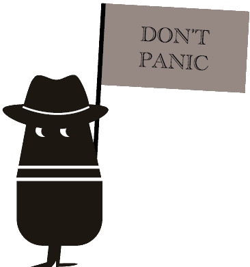

  

<h1 align="center">Agency 42</h1>

  <strong>Sweden's go-to Kubernetes specialists.</strong> 
  Kubernetes · OpenShift · Rancher · Linux · DevSecOps

  <a href="https://agency42.se">agency42.se</a> ·
  <a href="https://www.linkedin.com/company/agency42ab">LinkedIn</a>

---

## Don't panic.

Your pods are in `CrashLoopBackOff`, the ingress has stopped answering, and someone has just typed `kubectl delete` in the wrong context. Take a breath and grab your towel. **Agent Le'man** (that's *A Gent Le'man*, in the black fedora) has seen this before.

We're an engineering consultancy from Sweden. We design, build, harden and rescue container platforms, and when they break at 03:00 we fix them. We like clusters that are boring, upgrades that are uneventful and on-call rotations that are quiet.

## What we do

| | |
|---|---|
| **Kubernetes** | Platform design, cluster lifecycle, upgrades, multi-tenancy, GitOps (Argo CD / Flux), observability, and troubleshooting when it's on fire. |
| **OpenShift** | OpenShift 4.x installs and upgrades, Operators, OpenShift GitOps & Pipelines, SCCs, and migrations to and from vanilla Kubernetes. |
| **Rancher / RKE2** | Rancher fleet management and CIS-hardened RKE2 and K3s clusters, on-prem, at the edge and in air-gapped environments. |
| **Linux** | The layer everything else stands on: RHEL, Ubuntu and SUSE, hardening, automation with Ansible, and performance tuning. |
| **DevSecOps** | Secure supply chains (SBOMs, signing, scanning), policy-as-code with Kyverno and OPA, secrets management, and CI/CD that developers don't hate. |
| **Cloud** | AWS and Azure (EKS, AKS, and the networking and IAM around them), with Terraform throughout. |

Where it matters, we map platforms to NIS2, CRA and ISO 27001 as well, but good engineering comes first.

### About the robots

Our engineers use AI agents to handle the tedious parts, such as trawling logs, drafting runbooks and diffing manifests at 2 a.m. That gives them more time for the parts that need a brain. The agents assist and humans decide. Nobody gets replaced by a shell script with opinions.

## What's in here

| Repository | What it is |
|---|---|
| [`kubernetes-best-practices`](https://github.com/Agency-42/kubernetes-best-practices) | Example manifests and checklists for Kubernetes, OpenShift and RKE2, starting with NetworkPolicies that don't break DNS. Work in progress, growing every week. |
| [`devops-templates`](https://github.com/Agency-42/devops-templates) | Starter templates for CI/CD, Terraform and containers. It's a work in progress, and we're expanding it. |
| **`dont-panic`** *(coming soon)* | Our flagship **Kubernetes troubleshooting field guide**: symptom → diagnosis → fix, written by people who've been paged. |

### Coming soon: `dont-panic`

> *"A Kubernetes cluster is mostly harmless. Mostly."*

A field guide for the moment things go sideways. Pods stuck in `Pending`, `ImagePullBackOff`, OOMKills, DNS that isn't, certificates that expired last Tuesday, etcd with feelings. Each entry covers:

1. **What you see**: the symptom, and the exact error you're googling.
2. **What's actually going on**: the plain-English reason.
3. **How to confirm it**: copy-paste `kubectl` / `oc` commands.
4. **How to fix it**, and how to make sure it doesn't happen again.

It covers vanilla Kubernetes, OpenShift and RKE2, noting where they differ. Follow us here to catch the launch.

## Work with us

Need a platform built, a cluster hardened, an OpenShift or Rancher upgrade that doesn't ruin a weekend, or a second opinion before go-live? Our team is happy to help.

**[agency42.se](https://agency42.se)** · **[LinkedIn](https://www.linkedin.com/company/agency42ab)**

Issues and PRs on our public repos are welcome. If you've found a better way to do something, we want to hear about it.

So long, and thanks for all the pods. 🐬

